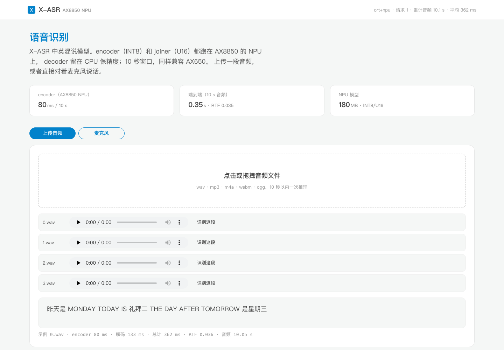
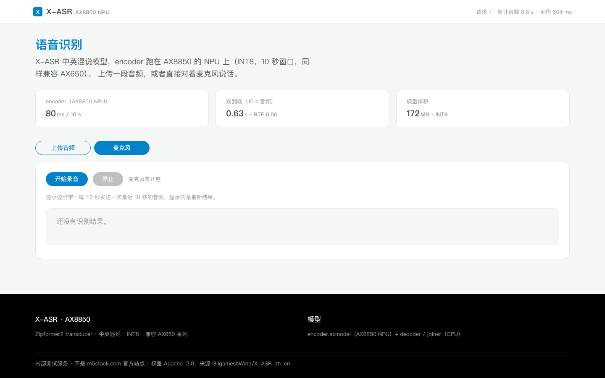
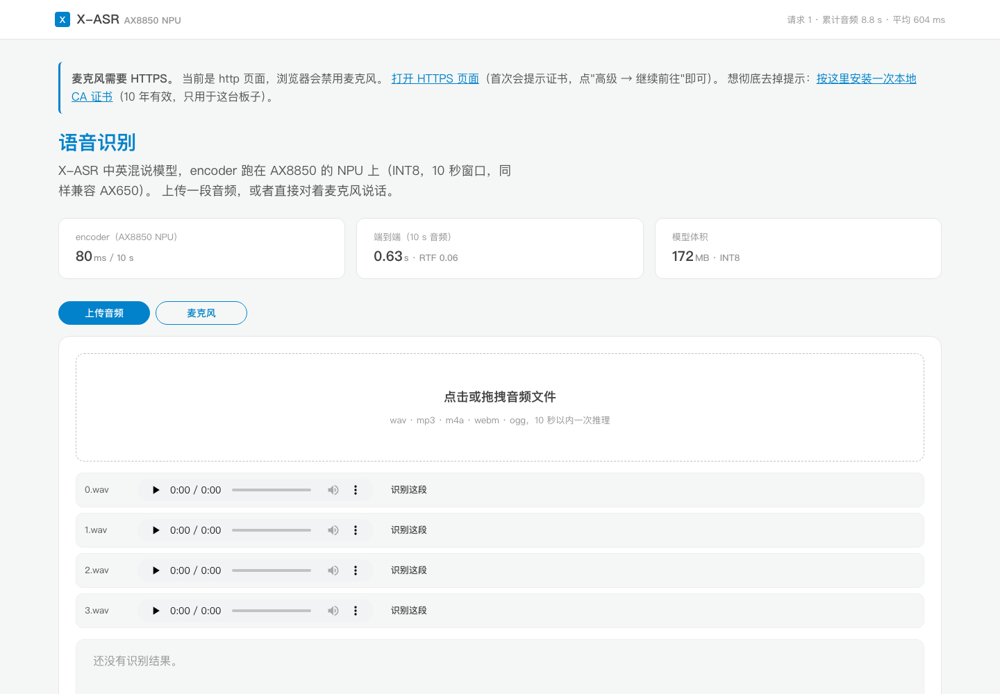
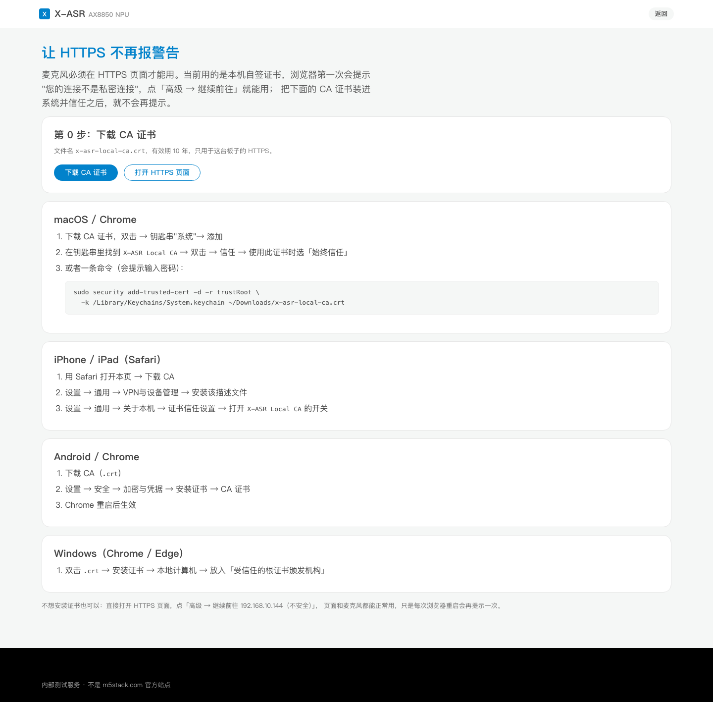

# X-ASR → AX8850 AXMODEL（兼容 AX650）

把 [X-ASR-zh-en](https://huggingface.co/GilgameshWind/X-ASR-zh-en)（0.16B，Zipformer2 transducer，
中英双语，Apache-2.0）的离线 encoder 转换成 AXERA AX8850 的 axmodel（编译目标 AX650，AX650 系列同包兼容），并给出板端推理与复现流程。

转换时对照了 AXERA 官方的 [zipformer.axera](https://github.com/AXERA-TECH/zipformer.axera) 工程：
官方用 `cut_reciprocal_encoder.py` 把 NPU 不支持的 `Reciprocal` 换成 `Div`；我们这边对应的是
把 `Log(1+Exp(-abs(x)))`（SwooshL/SwooshR 激活）换成 `Softplus` —— 这一步把图从
33 个子图收敛到 1 个 NPU 子图，是精度和编译时间都变好的关键。
官方默认的 U16 混合量化与 SmoothQuant 也试过，但 Pulsar2 的 cmodel 仿真在 U16 上会崩、
SmoothQuant 编译被 SIGTERM，最终交付纯 INT8（质量与 sherpa-onnx 官方 int8 模型同量级）。

## 板端实机（AX8850，2026-11-11 验证）

网页直接跑在板子上（AX8850，模型与 AX650 兼容），局域网任意设备可访问：

| 入口 | 功能 |
|---|---|
| **https://192.168.10.144/** | 上传音频 + 示例试听 + **麦克风实时识别** |
| http://192.168.10.144/ | 上传 / 试听（浏览器在 http 下禁用麦克风） |
| http://192.168.10.144/setup | HTTPS 证书安装说明（装一次 CA，警告消失） |

> 首次打开 HTTPS 会提示"您的连接不是私密连接"，点 **高级 → 继续前往** 即可；
> 想彻底去掉提示：访问 `/setup` 按说明安装本地 CA（10 年有效，只用于这台板子）。

页面按 M5Stack 官网设计语言实现（蓝色标题、1px 细描边卡片、胶囊按钮、黑色页脚），
支持文件上传 / 示例音频 / 麦克风实时识别，桌面与手机都能用。

| 上传 + 示例试听 + 识别结果（头部显示 `ort+npu` 后端） | 麦克风 |
|---|---|
|  |  |

http 访问时页面会提示麦克风需要 HTTPS：
装一次本地 CA 就能彻底去掉证书警告：

实测（10.05 s 音频）：encoder **80 ms**（NPU）+ joiner **70 ms**（NPU，U16）+ decoder 38 ms（CPU）+ fbank 145 ms
= **360 ms，RTF 0.036**（decoder/joiner 取舍见 `reports/07-aux-on-npu.md`）；
4 条测试音频里 **2 条与 fp32 ONNX 完全一致**，另 2 条只有英文词/近音差异。
部署细节见 [deploy/board/README.md](deploy/board/README.md)，性能报告 `reports/06-board-deploy.md`。

## 已发布的产物

| 产物 | 位置 |
|---|---|
| sherpa-onnx PR（转换流水线） | <https://github.com/k2-fsa/sherpa-onnx/pull/4185> |
| 板端模型（encoder.axmodel + decoder/joiner.onnx + tokens + 测试音频） | <https://huggingface.co/yunyu1258/x-asr-axmodel> |

## 板端用（模型下载后一行跑）

```bash
pip install axengine numpy
huggingface-cli download yunyu1258/x-asr-axmodel --local-dir models
python deploy/python/run_asr.py --models-dir models --audio models/test_wavs/0.wav
```

详细步骤见 [deploy/README.md](deploy/README.md)。模型仓库：<https://huggingface.co/yunyu1258/x-asr-axmodel>

## 现状

| 阶段 | 状态 | 产物 / 报告 |
|---|---|---|
| 0. 模型来源与导出方案 | ✅ | `docs/02-decisions.md` |
| 1. fp32 静态 ONNX 导出 | ✅ | `onnx/encoder.fp32.onnx`（571 MB），导出文本与 sherpa int8 逐字一致 |
| 2. If 展开（43→0） | ✅ | `scripts/host/25_fold_if.py`，cosine 1.0 / max diff 0 |
| 3. shape 计算链冻结（2477 个） | ✅ | `scripts/host/26_freeze_shapes.py`，节点 10775→4819 |
| 3.5 Log→Softplus（99 处） | ✅ | `scripts/host/27_fold_swoosh.py`，33 子图 → **1 个 NPU 子图**，cosine 1.0 |
| 4. Pulsar2 编译 | ✅ | `model.axmodel` 165 MB，**17.12 GMAC / 10 s**，单 NPU 子图 |
| 5. 精度验收（cosine ≥ 0.99） | ✅ | **cosine 0.999012**，端到端文本与 ONNX 逐 token 一致，见 `reports/03-simulate.md` |
| 6. 板端推理 + 部署文档 | ✅ | AX8850 实机跑通：`deploy/board/`（ctypes 引擎 + Flask 网页服务），RTF 0.036 |
| 6.5 decoder / joiner 上 NPU | ✅ | joiner U16 上 NPU（0.28 ms/帧，域内文本与 fp32 一致）；decoder 可上 NPU（`aux_backend="npu"`） |
| 7. HF 模型发布 | ✅ | <https://huggingface.co/yunyu1258/x-asr-axmodel> |
| 8. 上游 sherpa-onnx PR | ✅ | <https://github.com/k2-fsa/sherpa-onnx/pull/4185> |

## 精度结果

Pulsar2 仿真（target_hardware=AX650，AX8850 同包兼容），同一批音频、同一套 fbank：

| wav | cosine（ONNX vs AXMODEL） | 文本（相对 fp32 ONNX 的 token 编辑距离） | 对照：sherpa-onnx 官方 int8 |
|---|---|---|---|
| 0 | 0.999012 | 0 | 0 |
| 1 | 0.998276 | 10（`ALWAYS ALWAYS`→`OS OS`） | 0 |
| 2 | 0.996739 | 2 | 3 |
| 3 | 0.998375 | 2 | 5 |
| 合计 | min 0.9967 | 14 | 8 |

**结论**：cosine 全部 ≥0.99；文本质量与 sherpa-onnx 官方 int8 模型同量级
（2 条更准、1 条持平、1 条英文重复词更差）。详见 `reports/03-simulate.md`。

## 为什么是「离线 10 秒窗口」

- 离线 encoder 是**无状态单次前向**（`x[1,1000,80] → encoder_out[1,248,512]`），最容易在 NPU 上
  跑通，部署也最简单（不需要管理几十个 cache 状态张量）；
- 精度上离线档也是 X-ASR 最强的一档（WenetSpeech net/meeting 5.83/7.06）；
- 10 s 覆盖绝大多数一句话场景，更长的音频按 8 s 步长切窗。

流式版本（160/480/960/1920 ms）留作后续：需要状态张量管理 + 与
[zipformer.axera](https://github.com/AXERA-TECH/zipformer.axera) 类似的 segment/shift 调度。

## 目录

```
scripts/host/     转换流水线（00_setup → 10_export → 20/21 校准 → 25_fold_if → 26_freeze_shapes
                  → 27_fold_swoosh → 40_build → 50/51/52 验证 → 60_upload_hf）
configs/          已发布模型对应的 Pulsar2 配置（pulsar2-released.json）
scripts/host/k2stub/   k2 wheel 与 torch 2.x 不兼容，用 stub 顶掉
scripts/local/    本机验证（fbank 数值等价）
deploy/           板端部署（Python 推理 + 说明）
docs/             流水线、决策记录、上游 PR 计划
reports/          转换/仿真/踩坑记录
assets/           tokens.txt（Apache-2.0，来源见 NOTICE）
```

## 环境

- 转换主机：`m5stack@192.168.20.38`（Ubuntu 24.04 / x86_64 / 16 核 / 62 GB）
  - Magnetar `~/AX-model/Magnetar`，Pulsar2 8.0 `~/.cache/magnetar/pulsar2/8.0`
  - base venv：Python 3.10 + torch 2.14.1+cpu + onnx 1.22 + ort 1.23.2
- 目标芯片：AX8850（编译目标 AX650，已在 AX8850 实机验证）

## 复现

```bash
# 目标机上（一次性）
bash scripts/host/00_setup.sh
# 全流程（导出 → 校准 → 编译 → 仿真 → 字级一致性）
bash scripts/host/run_all.sh
```

细节见 [docs/01-pipeline.md](docs/01-pipeline.md)。

## 许可

- 转换脚本与文档：Apache-2.0
- 模型权重来自 X-ASR（Apache-2.0），见 `assets/NOTICE.md`
